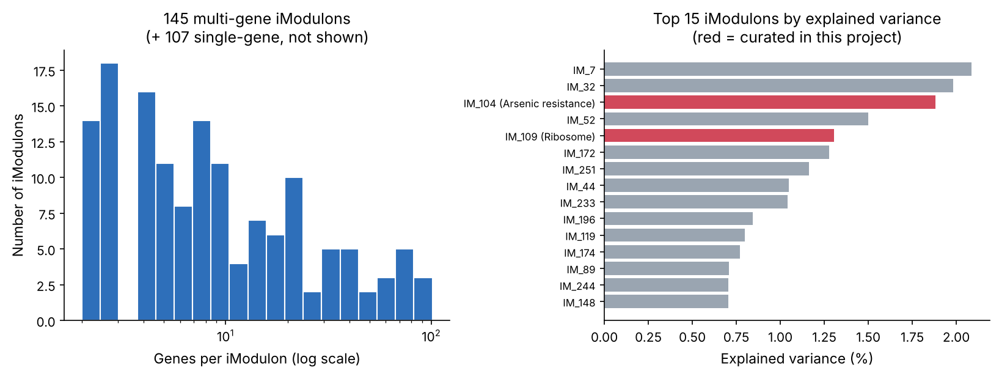
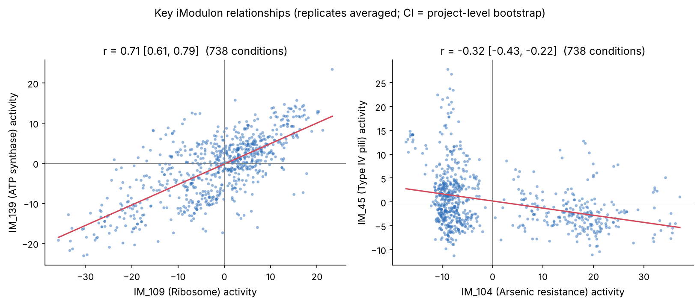
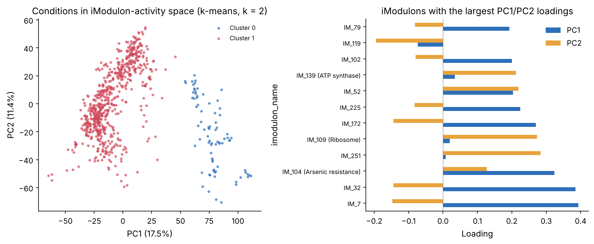
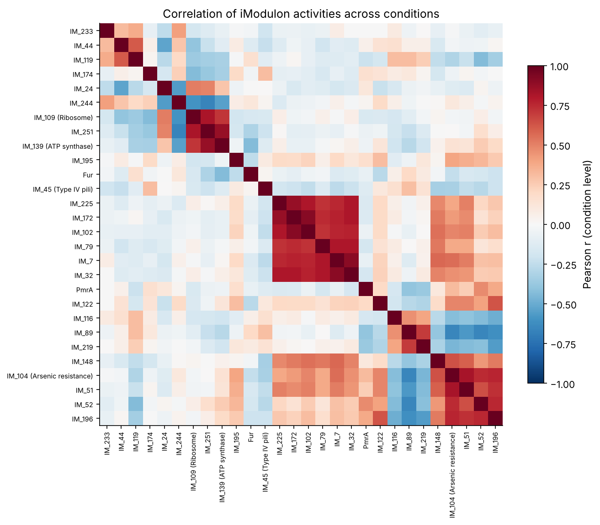

# iModulon Transcriptomics of *Acinetobacter baumannii*

**Author:** Jade Cruz

*A. baumannii* is a multidrug-resistant, hospital-acquired pathogen. This project uses **Independent Component Analysis (ICA)** on 1,498 public RNA-seq samples to break its transcriptome into **iModulons**: groups of genes that rise and fall together because a shared regulator controls them. The project then asks how these regulatory programs relate to each other across conditions.

| | |
|---|---|
| RNA-seq samples | **1,498** (NCBI SRA / GEO) |
| Independent projects | **136** |
| Genes | **3,718** |
| iModulons | **252** (145 multi-gene, 107 single-gene) |
| Expression variance explained | **66.2%** |
| Database | Uploaded to iModulonDB; validator: 0 failed checks |



## How ICA works here (one paragraph)
The expression matrix **X** (genes × samples) is factored as **X ≈ M · A**. Each column of **M** is an independent component: gene weights, where genes above a threshold form the iModulon. Each row of **A** is that iModulon's **activity** in every sample. PCA finds directions of maximal variance that are orthogonal. ICA instead finds components that are *statistically independent* (maximally non-Gaussian), which tends to line up with real regulators, because each regulator acts on its own set of genes.

## Key findings



| Pair | Sample-level r | Condition-level r [95% project-bootstrap CI] | Within-project median r (same sign) |
|---|---|---|---|
| Ribosome (IM_109) vs ATP synthase (IM_139) | 0.72 | **0.71** [0.61, 0.79] | 0.64 (86% of 88 projects) |
| Arsenic resistance (IM_104) vs Type IV pili (IM_45) | −0.34 | **−0.32** [−0.43, −0.22] | −0.35 (63% of 70 projects) |

1. **Growth program: protein synthesis and energy production move together.** The ribosome and ATP-synthase iModulons are strongly correlated. The relationship holds after averaging replicates and resampling whole studies, and it shows up inside 86% of individual studies. This matches the textbook growth-rate coupling of translation and energy supply.
2. **Possible stress-vs-motility trade-off.** Arsenic-resistance activity is inversely related to type IV pili (twitching motility and biofilm). The effect is moderate and the bootstrap CI excludes zero, but it is **less consistent**: about 1 in 3 studies show the opposite sign. The arsenic iModulon is also essentially "on/off" (see the bimodal scatter), and it is high in conditions with no arsenic added (VBNC state, stationary phase). So it likely reflects strain background or a general stress state as much as arsenic exposure itself. **Hypothesis to test:** arsenic exposure reduces pili expression and biofilm formation. That would need a controlled experiment, not just this correlation.

### Condition structure



PCA on condition-level activity: PC1 explains 17.5% and PC2 11.4%. The silhouette score picks **k = 2** clusters. A small, well-separated cluster (80 conditions) is dominated by the VBNC-state and PmrAB studies and is driven by IM_7, IM_32 and the arsenic iModulon. The ribosome and ATP-synthase iModulons load together on PC2, consistent with finding 1.



## What the polished analysis adds
The original Phase 4 report computed correlations across all 1,498 samples. Samples within a study (replicates, the same strain and lab) are not independent, so this version:
- **averages replicates** to the condition level before correlating;
- reports a **cluster (project-level) bootstrap** CI that respects study structure;
- checks **within-project** correlations to separate real co-regulation from between-study differences;
- chooses k for k-means by **silhouette score** instead of fixing it by hand.

## Project phases
| Phase | What was done | Report |
|---|---|---|
| 1. iModulonMiner | Ran the iModulonMiner pipeline (QC → ICA) to produce the M and A matrices | `phase1_imodulonminer/` |
| 2. Metadata curation | Curated 136 projects / 705 conditions, mapped UniProt IDs (~100%), validated and uploaded to iModulonDB | `phase2_metadata_curation/phase2_report.pdf` |
| 3. Biological curation | Annotated iModulons with functions and regulators (e.g. PmrA, Fur, arsenic, ribosome, ATP synthase) | `phase3_biological_curation/Phase3_report.pdf` |
| 4. Deep analysis | Correlation, PCA, clustering, phase-plane and condition profiling | `phase4_deep_analysis/` |
| Polished analysis | Reproducible script, robustness checks, new figures | `analysis/`, `figures/`, `results/` |

## Reproduce
```bash
pip install pandas numpy scipy scikit-learn matplotlib
python analysis/imodulon_analysis.py   # ~30 s; writes figures/ and results/
```

## Limitations
- 42% of iModulons are single-gene components. These often capture noise or one strongly varying gene, which suggests the decomposition dimension could be reduced.
- The samples mix several strains (ATCC 17978, ATCC 19606, AB5075, clinical isolates), and gene content differs between them.
- All findings are correlational. Regulator assignments rely on a small curated TRN.

## Tools
Python (pandas, NumPy, SciPy, scikit-learn, matplotlib), iModulonMiner, iModulonDB, NCBI SRA/GEO
