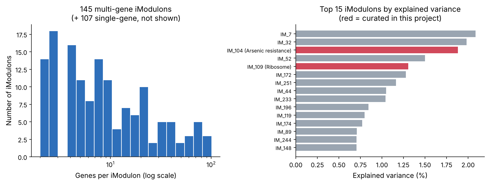
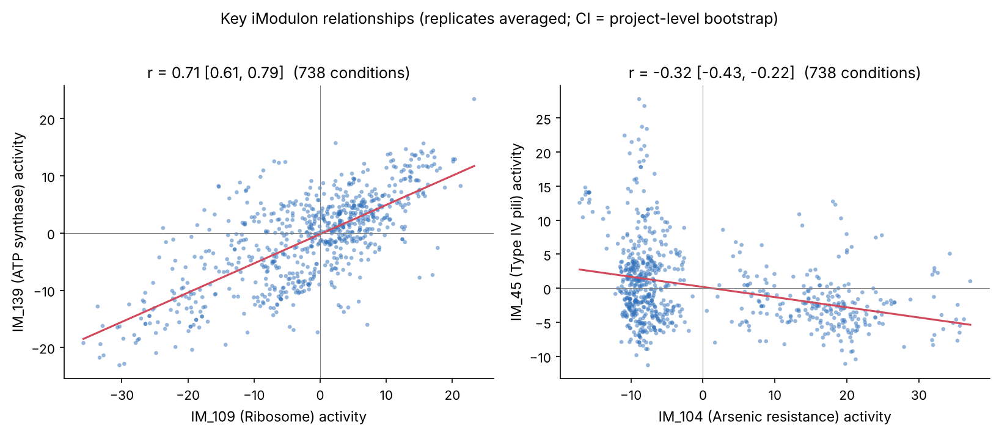
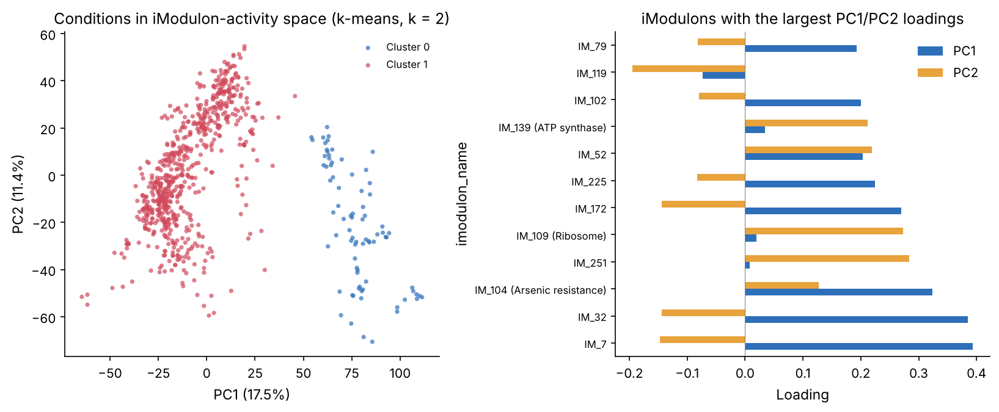

# Independently Modulated Gene Sets in *Acinetobacter baumannii* Across 1,498 Transcriptomes

**Jade Cruz**
Original Investigation · Microbial Genomics

---

## Key Points

**Question** Which regulatory programs in *Acinetobacter baumannii* turn on and off together, and do those relationships hold up after accounting for the fact that samples come in studies?

**Findings** Independent component analysis of 1,498 RNA-seq samples from 136 studies identified 252 independently modulated gene sets (iModulons) that explained 66.2% of expression variance. Ribosome and ATP synthase activity were strongly correlated (*r* = 0.71; 95% CI, 0.61-0.79), and the correlation held in 86% of individual studies. Arsenic resistance and type IV pili activity were inversely correlated (*r* = −0.32; 95% CI, −0.43 to −0.22), but in only 63% of studies.

**Meaning** Growth-related programs in *A. baumannii* are tightly coordinated. The proposed trade-off between metal detoxification and pili-driven biofilm formation is a hypothesis worth testing experimentally, not an established finding.

---

## Abstract

**Importance** *A. baumannii* is a hospital-acquired pathogen that is increasingly resistant to last-line antibiotics. Its regulatory network is poorly mapped, which makes large expression datasets hard to interpret.

**Objective** To break the *A. baumannii* transcriptome into independently regulated gene sets, annotate their biological functions, and test which programs are coordinated across conditions using methods that respect study structure.

**Design, Setting, and Participants** A secondary analysis of 1,498 public RNA-seq samples from 136 projects in the National Center for Biotechnology Information Sequence Read Archive and Gene Expression Omnibus. The samples covered antibiotic exposure, stress, virulence, biofilm and gene-knockout experiments.

**Exposures** Experimental condition (738 project-condition groups).

**Main Outcomes and Measures** iModulon gene membership, explained variance, regulator enrichment and activity. Associations between iModulon activities were measured with Pearson correlation at the condition level, with 95% CIs from a project-level cluster bootstrap (2,000 resamples) and consistency within each project.

**Results** The 252 iModulons covered 3,718 genes and explained 66.2% of expression variance. Three matched known regulons (BfmR, Fur and PmrA), 79 had partial functional annotation, 107 (42%) were single-gene components, and 63 had no known function. The BfmR iModulon (IM_222) matched its regulon perfectly (precision and recall, 1.00). Ribosome (IM_109) and ATP synthase (IM_139) activities were strongly correlated (*r* = 0.71; 95% CI, 0.61-0.79; median within-project *r* = 0.64). Arsenic resistance (IM_104) and type IV pili (IM_45) activities were inversely correlated (*r* = −0.32; 95% CI, −0.43 to −0.22; median within-project *r* = −0.35), but with the same sign in only 44 of 70 projects (63%). Stress-related iModulons (BfmR, PmrA, Fur and arsenic) were largely uncorrelated with each other (all *r* < 0.25).

**Conclusions and Relevance** Coordinated regulation of protein synthesis and energy production in *A. baumannii* was robust across studies, and stress responses behaved as separate, condition-specific programs. Whether metal stress suppresses biofilm formation will need controlled experiments to confirm.

---

## Introduction

*Acinetobacter baumannii* is a gram-negative bacterium that has become a major cause of serious infections in health care settings worldwide.¹ It causes pneumonia, bloodstream infections, urinary tract infections and wound infections. The burden is highest in intensive care patients on mechanical ventilation or with invasive devices.² Many strains resist multiple antibiotics, including last-resort drugs such as colistin, so the World Health Organization lists *A. baumannii* as a critical priority pathogen.¹,³ What makes this bacterium especially hard to control is that it can survive for long periods on dry hospital surfaces and readily acquires new resistance genes from other bacteria.¹

Developing new treatments depends on understanding how *A. baumannii* controls its genes, and that knowledge is still limited. For the ATCC 19606 reference strain, only 29 regulatory interactions covering 7 transcription factors have been confirmed experimentally. Without a fuller regulatory map, it is difficult to tell from large expression datasets which genes respond to which signals, and why.

Independent component analysis (ICA) is an unsupervised machine learning method that helps fill this gap.⁴,⁵ ICA splits a gene expression matrix **X** into 2 parts, **X ≈ M · A**. Each column of the gene weight matrix **M** describes one component, and the genes with large weights form an *iModulon* (an independently modulated gene set). Each row of the activity matrix **A** describes how active that iModulon is in every sample. Principal component analysis (PCA) looks for orthogonal directions that capture the most variance. ICA instead looks for components that are statistically independent, and these tend to line up with real regulators, because each regulator controls its own group of genes. ICA has already been applied to *A. baumannii* at a smaller scale, where it recovered 49 iModulons.⁴ The iModulonDB platform provides dashboards for exploring each iModulon's genes, activity and overlap with known regulons.⁵

This study built and curated a larger *A. baumannii* iModulon compendium and asked 4 questions. First, which regulatory programs are active together? Second, do conditions group by their overall regulatory state? Third, how does activity shift between antibiotic stress, growth and virulence? Fourth, do the relationships hold *within* individual studies, or only across them? The fourth question matters because samples from the same lab, strain and protocol are not independent. Treating them as independent can make correlations look stronger and more certain than they are.

## Methods

### Data Collection and Curation
RNA-seq samples were identified by BioProject and BioSample identifiers in the NCBI Sequence Read Archive and Gene Expression Omnibus. The final compendium contained 1,498 samples from 136 projects. The largest groups of reference strains were ATCC 17978 (618 samples), clinical isolates (365), AB5075 (215), strain 34654 (147) and ATCC 19606 (123). Reads were aligned to the ATCC 19606 reference genome (FQU82 locus tags).

Condition labels were standardized to 705 unique conditions. Replicate numbers were removed from condition names, and each sub-experiment was kept separate (for example, low and high doses of the same antibiotic were labeled separately). Genetic perturbations were annotated for 6 samples with gene deletions and 21 with point mutations, all mapping to the gene annotation file. UniProt identifiers were assigned to all 3,731 annotated genes (100% coverage), and 3,729 (99.95%) mapped correctly to *A. baumannii* ATCC 19606. Thirteen duplicate UniProt identifiers (0.3%) reflected paralogous genes with identical protein sequences and were kept. Of the 1,498 samples, 1,092 (72.9%) were linked to a publication DOI. A transcriptional regulatory network of 29 literature-supported interactions covering 7 regulators (Fur, Zur, PmrA, PmrB, DnaA, OxyR and SoxR) was compiled. The curated dataset passed iModulonDB validation with 0 failed checks.

### Independent Component Analysis
The compendium was processed with the iModulonMiner pipeline,⁵ which performs quality control, normalization to log-transformed transcripts per million (log-TPM) and repeated ICA with the optICA workflow to select a robust number of components. iModulon membership was set by gene-weight thresholds. Each iModulon was compared with known regulons using precision (the share of iModulon genes in the regulon) and recall (the share of regulon genes captured by the iModulon). iModulons were then annotated by function, regulator and Clusters of Orthologous Groups (COG) category.

### Statistical Analysis
Biological replicates were averaged within each project-condition pair, so each condition counted once (738 conditions). The following were then calculated:

1. **Condition-level correlations** (Pearson and Spearman) between iModulon activities.
2. **Project-level cluster bootstrap.** Whole projects were resampled with replacement 2,000 times to build 95% CIs that reflect between-study variability.
3. **Within-project correlations** for projects with at least 6 samples and real variation in both iModulons. This separates true co-regulation from differences between studies, such as strain or growth medium.
4. **PCA and k-means clustering** on condition-level activity profiles. The number of clusters (*k* = 2-8) was chosen by silhouette score.
5. **Phase-plane analysis.** Each sample was placed on 2 axes, PmrA minus ribosome activity (antibiotic stress vs growth) and BfmR minus ATP synthase activity (virulence and biofilm vs basic cell function), to map broad behavioral states.

Analyses used Python 3 (pandas, NumPy, SciPy, scikit-learn and matplotlib). Code is in `analysis/imodulon_analysis.py`.

## Results

### Decomposition Overview
The 252 iModulons explained 66.2% of total expression variance across 3,718 genes. The remaining 33.8% likely reflects noise or variation not captured by independent components. Three iModulons matched known regulons, 79 had partial functional annotation, 107 (42%) were single-gene components and 63 had no known function, mostly made up of hypothetical proteins. That large share of uncharacterized genes highlights how little experimental work exists for this organism. The 5 iModulons explaining the most variance were IM_7 (2.1%; 77 genes), IM_32 (2.0%; 56 genes), IM_104 (arsenic resistance; 1.9%; 6 genes), IM_52 (1.5%; 11 genes) and IM_109 (ribosome; 1.3%; 38 genes). The largest iModulon contained 101 genes (**Figure 1**).

**Figure 1.** Left, size distribution of multi-gene iModulons. Right, the 15 iModulons explaining the most variance; curated iModulons are shown in red.

### Biological Annotation of Key iModulons
Seven iModulons representing regulation, stress response, metabolism and motility were annotated in detail (**Table 1**).

**BfmR (IM_222).** BfmR is the response regulator of the BfmRS 2-component system, which controls biofilm formation, fimbriae production and stress responses.⁶,⁷ IM_222 contained 5 genes and overlapped perfectly with the BfmR regulon (precision and recall, 1.00). Its highest-weight genes encode a fimbrial chaperone (*yadV_2*), an outer membrane usher (*htrE_2*), the major fimbrial subunit (*smf-1_2*) and a fimbrial adhesin (*mrkD_2*). All 5 genes clustered within a narrow region of the chromosome, consistent with a single co-regulated fimbrial operon. Activity peaked when CavA, a protein that appears to restrain BfmR, was mutated, and was lowest under polymyxin B treatment.⁶

**Fur (IM_209).** The ferric uptake regulator (Fur) represses iron uptake genes when iron is plentiful.⁸ IM_209 contained 3 genes, 2 of which belong to the 7-gene Fur regulon (precision, 0.67; recall, 0.29). As expected for a repressor, Fur expression was weakly negatively related to IM_209 activity (*R*² = 0.05).

**PmrA.** PmrA controls modification of lipopolysaccharide on the outer membrane, which makes it harder for colistin and other polymyxins to bind and kill the cell.³ The PmrA iModulon tracked expression of its member gene *pgaB* closely across all samples (*R*² = 0.75), and most strongly in the AB5075 polymyxin response project (*R*² = 0.94). The relationship was weak in general antibiotic-response studies, which suggests PmrA responds specifically to polymyxins rather than to antibiotic stress in general.

**Arsenic resistance (IM_104).** This compact iModulon contained 6 genes for an arsenite efflux pump (*arsB*), arsenate reductase (*arsC*), a reductase (*arsH*) and the arsenic-responsive repressor (*arsR*). Together these detect arsenic, reduce arsenate to arsenite and pump it out of the cell.⁹ Despite its small size, it was the third-highest-variance iModulon, and *arsR* expression tracked its activity almost perfectly (*R*² = 0.96).

**Ribosome (IM_109) and ATP synthase (IM_139).** IM_109 contained 38 genes encoding 50S and 30S ribosomal proteins and elongation factor G. IM_139 contained 23 genes encoding ATP synthase subunits (*atpA*, *atpG* and *atpD1*) and NADH-quinone oxidoreductase subunits (*nuoC* through *nuoH*), core parts of respiration and ATP production.¹²

**Type IV pili (IM_45).** IM_45 contained 35 genes, including twitching motility proteins (*pilT_1* and *pilT_2*), type II secretion components and signal transduction regulators. Type IV pili are hair-like surface structures that let *A. baumannii* move across and attach to surfaces, which are early steps in biofilm formation.¹⁰,¹¹,¹³

**Table 1. Curated iModulons**

| iModulon | Function | Genes | Explained variance, % | Regulon match |
|---|---|---|---|---|
| IM_222 | BfmR: fimbriae and biofilm initiation | 5 | 0.41 | Precision 1.00, recall 1.00 |
| IM_209 | Fur: iron uptake | 3 | 0.08 | Precision 0.67, recall 0.29 |
| PmrA | Lipopolysaccharide modification, polymyxin resistance | 4 | 0.15 | Not mapped |
| IM_104 | Arsenic resistance | 6 | 1.88 | Not mapped |
| IM_109 | Ribosome, translation | 38 | 1.31 | Not mapped |
| IM_139 | ATP synthase, respiration | 23 | 0.68 | Not mapped |
| IM_45 | Type IV pili, twitching motility | 35 | 0.49 | Not mapped |

### Condition-Specific Activity
Different programs were active in different settings. Ribosome and ATP synthase activity were highest in growth-focused projects (AbaumPRECISE and the baseline transcriptome), and PmrA peaked under polymyxin exposure. Arsenic resistance was most active in conditions with no added arsenic, such as viable-but-nonculturable cells and stationary phase, and low in antibiotic studies. Type IV pili activity was elevated across many antibiotic conditions. On the phase plane, antibiotic-response samples fell in the high-stress, high-virulence quadrant, growth samples in the low-stress, high-growth quadrant, and genetic perturbation samples spread across all 4 quadrants.

### Coordinated Growth Program
Ribosome and ATP synthase activities were strongly and consistently correlated (**Table 2**; **Figure 2**). The correlation was almost unchanged after averaging replicates (sample level, *r* = 0.716; condition level, *r* = 0.715), and it held inside 76 of 88 projects (86%). In contrast, the 4 stress-related iModulons (BfmR, PmrA, Fur and arsenic) showed little correlation with each other (all *r* < 0.25).

**Table 2. Associations Between Key iModulon Activities**

| Pair | Condition-level *r* (95% CI)ᵃ | Spearman ρ | Within-project median *r* | Same sign, No./total (%) |
|---|---|---|---|---|
| Ribosome vs ATP synthase | 0.71 (0.61 to 0.79) | 0.67 | 0.64 | 76/88 (86) |
| Arsenic resistance vs type IV pili | −0.32 (−0.43 to −0.22) | −0.33 | −0.35 | 44/70 (63) |

ᵃ 95% CI from a project-level cluster bootstrap (2,000 resamples); n = 738 conditions.

**Figure 2.** Condition-level activity of the 2 key iModulon pairs. Each point is 1 condition (replicates averaged).

### Arsenic Resistance and Type IV Pili
Arsenic resistance was inversely correlated with type IV pili, and the bootstrap CI excluded zero. When arsenic genes were highly active, pili genes tended to be less active, and the reverse. Two features call for caution, though. First, IM_104 activity was close to on/off (bimodal), so the correlation mostly reflects a difference between "on" and "off" conditions rather than a smooth relationship. Second, because IM_104 was most active where no arsenic was added, the iModulon may track strain background or a general stress state, not only arsenic exposure.

### Condition Structure
In PCA of condition-level activity across all 252 iModulons, the first 2 components explained 17.5% and 11.4% of variance. The silhouette score was highest at *k* = 2 (0.36). A cluster of 80 conditions, mainly from viable-but-nonculturable and PmrAB studies, separated clearly from the other 658. It was driven by IM_7, IM_32 and the arsenic iModulon (**Figure 3**). The ribosome and ATP synthase iModulons loaded together on the second component, consistent with the growth program described above. An earlier analysis restricted to the 7 curated iModulons found 5 interpretable clusters (antibiotic response, growth, genetic perturbation, sequencing reference and stress response), even though no condition labels were used.

**Figure 3.** Left, conditions in iModulon-activity space colored by k-means cluster. Right, iModulons with the largest loadings on the first 2 principal components.

## Discussion

### Growth-Linked Coordination
The strong relationship between the ribosome and ATP synthase iModulons fits basic bacterial physiology: ribosomes build proteins, and ATP synthase supplies the energy that process needs, so their activity rises and falls together during growth. *A. baumannii* relies on oxygen-based respiration, which makes ATP synthase central to its survival, and the enzyme has already been studied as a possible drug target.¹² The tight coupling found here suggests that disrupting energy production could also slow protein synthesis. No single regulator is known to control both iModulons, so the mechanism behind the coordination remains an open question. This relationship also served as a useful check on the method: it stayed strong once replicates and same-study samples were no longer treated as independent.

### A Possible Trade-off Between Metal Stress and Biofilm
The arsenic-pili relationship is more interesting but less certain. Type IV pili help *A. baumannii* twitch across surfaces and form biofilms, which are a major reason it persists on hospital equipment and resists treatment.¹⁰,¹¹ If metal stress suppresses pili, that would point to a trade-off between detoxification and colonization. The robustness checks show the association is real across the dataset but inconsistent between studies, and the arsenic iModulon was active even without added arsenic. It is best treated as a **hypothesis**: that arsenic exposure reduces type IV pili expression and biofilm formation. A controlled experiment that adds arsenite to a single strain and measures pili gene expression and biofilm mass would test this directly. Arsenic-based compounds have already been explored as antimicrobials against multidrug-resistant *A. baumannii*.⁹

### Independent Stress Responses
The weak correlations among the stress-related iModulons show that *A. baumannii* does not rely on one general stress response. PmrA responded to polymyxins, Fur to iron availability, BfmR to surface and regulatory signals, and the arsenic program to metal exposure. Because these programs are largely independent, activating one does not trigger the others. This may let the bacterium respond precisely to each threat without paying the cost of a broad, all-purpose response.

### Limitations
This study has several limitations. First, 42% of iModulons were single-gene components, which suggests the decomposition dimension was set higher than needed and that some components capture noise. Second, the samples mixed several strains but were aligned to the ATCC 19606 genome, and differences in gene content between strains can create apparent co-regulation. Third, all findings are correlational and cannot establish cause and effect. Fourth, the regulatory network for ATCC 19606 is small (29 interactions), so most iModulons could not be matched to a regulator, and 68 projects lacked a linked publication.

### Future Directions
Next steps include experimentally testing the arsenic-biofilm hypothesis, identifying the regulators of IM_109 and IM_139, expanding the regulatory network with chromatin immunoprecipitation sequencing (ChIP-seq) for key transcription factors, and comparing *A. baumannii* iModulons with those of related gram-negative pathogens. The 63 iModulons with no known function are a promising source of new biology.

## Conclusions

ICA recovered a robust, biologically sensible picture of *A. baumannii* regulation. It found a tightly coordinated growth program, separate condition-specific stress responses, and a possible trade-off between metal stress and pili-driven biofilm formation. Checking results at the condition and project level, not just across all samples, changed how strongly each finding can be claimed.

---

## References

1. Asif M, Alvi IA, Rehman SU. Insight into *Acinetobacter baumannii*: pathogenesis, global resistance, mechanisms of resistance, treatment options, and alternative modalities. *Infect Drug Resist*. 2018;11:1249-1260. doi:10.2147/IDR.S166750
2. Centers for Disease Control and Prevention. About *Acinetobacter*. June 12, 2025. Accessed 2025. https://www.cdc.gov/acinetobacter/about/index.html
3. Giles SK, et al. The StkSR two-component system influences colistin resistance in *Acinetobacter baumannii*. *Microorganisms*. 2022;10(5):985. doi:10.3390/microorganisms10050985
4. Menon ND, et al. Independent component analysis reveals 49 independently modulated gene sets within the global transcriptional regulatory architecture of multidrug-resistant *Acinetobacter baumannii*. *mSystems*. 2024. doi:10.1128/msystems.00606-23
5. Sastry AV, et al. iModulonMiner and PyModulon: software for unsupervised mining of gene expression compendia. *PLoS Comput Biol*. 2024;20(10):e1012546. doi:10.1371/journal.pcbi.1012546
6. Palethorpe S, et al. *Acinetobacter baumannii* regulates its stress responses via the BfmRS two-component regulatory system. *J Bacteriol*. 2022;204(2):e00494-21. doi:10.1128/jb.00494-21
7. Russo TA, et al. The response regulator BfmR is a potential drug target for *Acinetobacter baumannii*. *mSphere*. 2016;1(3):e00082-16. doi:10.1128/mSphere.00082-16
8. Steingard CH, Helmann JD. Meddling with metal sensors: Fur-family proteins as signaling hubs. *J Bacteriol*. 2023;205(4):e00022-23. doi:10.1128/jb.00022-23
9. Alhomaidi E, Al-Qahtani WH. Effect of arsenic green synthesis nanoparticles on multidrug-resistant *Acinetobacter baumannii*. *Green Mater*. Published online October 23, 2024:1-6. doi:10.1680/jgrma.24.00033
10. Harding CM, et al. *Acinetobacter baumannii* strain M2 produces type IV pili which play a role in natural transformation and twitching motility but not surface-associated motility. *mBio*. 2013;4(4):e00360-13. doi:10.1128/mBio.00360-13
11. Craig L, Pique ME, Tainer JA. Type IV pilus structure and bacterial pathogenicity. *Nat Rev Microbiol*. 2004;2(5):363-378. doi:10.1038/nrmicro885
12. Demmer JK, et al. Structure of ATP synthase from ESKAPE pathogen *Acinetobacter baumannii*. *Sci Adv*. 2022;8(7):eabl5966. doi:10.1126/sciadv.abl5966
13. Meng R, et al. Structural basis of *Acinetobacter* type IV pili targeting by an RNA virus. *Nat Commun*. 2024;15. doi:10.1038/s41467-024-47119-5
